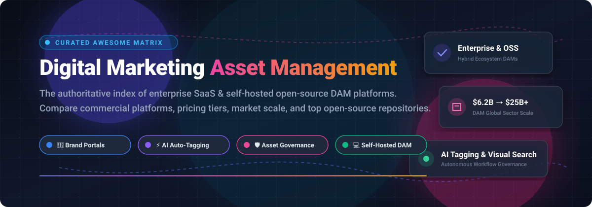
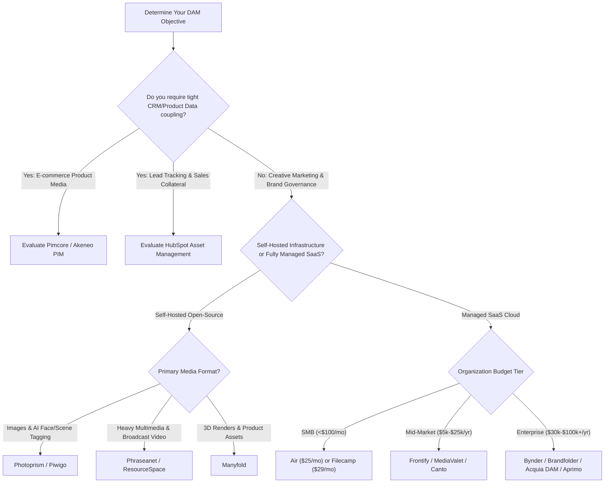

  

# 🚀 Awesome Digital Marketing Asset Management (DAM)

> 🌟 **A comprehensive, SEO-optimized, community-curated directory of Digital Marketing Asset Management (DAM) software, Brand Portals, Content Governance Suites, and Open-Source Self-Hosted Media Repositories.**

---

## 📑 Table of Contents
- [🌐 Sector Overview & Market Dynamics](#-sector-overview--market-dynamics)
- [💼 Commercial SaaS Platforms](#-commercial-saas-platforms)
- [🔓 Open-Source GitHub Projects](#-open-source-github-projects)
- [🎯 Choosing the Right DAM Architecture](#-choosing-the-right-dam-architecture)
- [🤝 How to Contribute](#-how-to-contribute)
- [⚖️ Disclaimer & Compliance](#-disclaimer--compliance)

---

## 🌐 Sector Overview & Market Dynamics

The global Digital Asset Management (DAM) market is currently valued between **$6.2 billion and $8.9 billion**, projected to exceed **$25 billion to $33 billion by the mid-2030s**, compounding at a robust **CAGR of 13%–18%**. 

From a competitive standpoint, the sector is **moderately fragmented**: broad industry adoption features intense competition across dozens of specialized, vertical-specific vendors (such as creative workflow DAMs, brand guideline hubs, and self-hosted open-source alternatives), while enterprise marketing cloud suites (such as Adobe Experience Manager and OpenText) and CRM giants (like HubSpot) command high concentration at the upper enterprise tier through bundled suites and corporate acquisitions.

---

## 💼 Commercial SaaS Platforms

Below is an overview of commercial SaaS DAM platforms, complete with verified base tier entry costs, free tier limits / trial durations, and company size (revenue / valuation), sorted in descending order of enterprise scale.

| Platform | Enterprise Scale (Revenue / Valuation) | Starting Pricing (Specific Tier) | Free Tier / Trial Limits | Key Features & Trade-offs |
| :--- | :--- | :--- | :--- | :--- |
| **[HubSpot Asset Management](https://www.hubspot.com/)** | **~$2.6B ARR** / ~$30B Market Cap | **$15/month** (Starter tier for paid marketing features & higher asset limits) | **Free Forever plan** (Max file upload limit: **20 MB per file**; **5 shared tracked sales documents**; HubSpot branding on hosted assets) | Native CRM asset repository and campaign file management; limited for complex high-resolution multi-format video pipelines. |
| **[Widen Collective (Acquia DAM)](https://www.acquia.com/products/dam)** | **~$400M ARR** (Acquia parent valuation ~$1B+) | **~$30,000/year** (Workgroup entry tier: up to 50 users, 1 TB storage, API up to 500k calls/mo) | **No Free Forever plan**; **Guided 14-day proof-of-concept / sandbox trial** upon sales request | Enterprise-grade governance, product information management (PIM) workflows, and deep CMS integrations; six-figure commitments at scale. |
| **[Aprimo](https://www.aprimo.com/)** | **~$200M+ ARR** / ~$800M Valuation | **$60,000/year** (Entry enterprise DAM package) | **No Free Forever plan**; **Interactive test drive / guided pilot** arranged via enterprise sales | Marketing resource management (MRM) synergy, enterprise compliance, and AI tagging; prohibitive entry price point for SMBs. |
| **[Bynder](https://www.bynder.com/)** | **~$150M+ ARR** / ~$600M Valuation | **~$450/month ($5,400/year)** (Entry-level deployment for core brand portal) | **No Free Forever plan**; **No self-service trial** (Guided sandbox demo / trial environment via sales consultation only) | Polished brand guidelines, templating engine, and creative review workflows; multi-year lock-in and sales-led pricing. |
| **[Brandfolder](https://brandfolder.com/)** (Smartsheet) | **~$150M Division Revenue** (Smartsheet $1B+ ARR) | **~$1,500/month ($18,000/year)** (Premium tier base contract) | **No Free Forever plan**; **No self-service trial** (Sandbox proof-of-concept on sales request; includes **unlimited free guest users** on paid plans) | Superior visual search, intuitive UI, and guest sharing; entirely sales-negotiated with no transparent public rate card. |
| **[Canto](https://www.canto.com/)** | **~$100M+ ARR** / Private Equity Backed | **~$25,000/year** (AWS Marketplace & direct entry deployment, ~2 TB storage bundled) | **No Free Forever plan**; **7-day free trial** with full system features (requested via website form) | Strong AI-driven auto-tagging, facial recognition, and curated team portals; opaque pricing tiers requiring sales consultation. |
| **[Frontify](https://www.frontify.com/)** | **~$50M+ ARR** / Series C (~$500M+ Valuation) | **$100/month ($1,200/year)** (Basic team seat packaging entry point) | **No Free Forever plan**; **14-day free trial** (No credit card required; access to brand guidelines & DAM core) | Unified brand asset hub combining design tokens, brand manuals, and digital assets; onboarding fees ($2k–$15k) and storage overages can escalate costs. |
| **[MediaValet](https://www.mediavalet.com/)** | **~$20M+ ARR** / ~$80M Market Cap | **~$300/month ($3,600/year)** (Base entry storage package) | **No Free Forever plan**; **Guided sandbox environment** granted after initial discovery demo | Pure storage-based pricing with **unlimited user seats**, built-in AI auto-tagging, and Azure cloud durability; video-heavy libraries face storage surcharges. |
| **[Air](https://air.inc/)** | **~$10M ARR** / Series B (~$100M+ Valuation) | **$25/month ($300/year)** (Starter tier: 200 GB storage, unlimited users) | **Free Forever plan** (Capped at **3 users**, **10 GB storage**, and **100 AI credits/month** [~20 AI images or 2 AI videos]) | Modern AI-native visual boards, creative asset feedback, and affordable micro-team tiering; credit metering for heavy generative AI workloads. |
| **[Filecamp](https://filecamp.com/)** | **~$5M ARR** / Bootstrapped & Profitable | **$29/month** (Basic tier: 20 GB storage, unlimited users, custom branding) | **No Free Forever plan**; **30-day free trial** (Full Professional features, **unlimited users**, no credit card required) | Extremely budget-friendly flat-rate pricing with unlimited users; lacks advanced AI auto-tagging and enterprise single-sign-on (SSO). |

---

## 🔓 Open-Source GitHub Projects

Explore battle-tested, self-hosted, and community-maintained open-source alternatives. Repositories are ranked in descending order of GitHub star count, featuring real-time star badges linking directly to their stargazers page.

| Repository | GitHub Stars Badge | Primary Focus & Capabilities | Tech Stack | License |
| :--- | :--- | :--- | :--- | :--- |
| **[Photoprism](https://github.com/photoprism/photoprism)** |  | 🤖 **AI-Powered Visual Asset Library**: Highly optimized for visual indexing, automatic face detection, reverse-geocoding, and semantic image classification. | Go, Vue.js, TensorFlow | AGPL-3.0 |
| **[Pimcore](https://github.com/pimcore/pimcore)** |  | 📦 **Enterprise DAM + PIM + DXP**: Full-scale master data management unifying digital marketing collateral, e-commerce product media, and omnichannel asset distribution. *(Note: POCL license limits free production use to organizations ≤€5M revenue).* | PHP, Symfony, MySQL | Pimcore Open Core / GPLv3 |
| **[Piwigo](https://github.com/Piwigo/Piwigo)** |  | 🖼️ **Photo & Media Management Gallery**: Lightweight, extensible web gallery with 200+ community plugins, batch uploaders, metadata management (EXIF/IPTC), and multi-level privacy controls. | PHP, MySQL, JavaScript | GPL-2.0 |
| **[Manyfold](https://github.com/manyfold3d/manyfold)** |  | 📐 **3D & Multidimensional Creative DAM**: Specialized self-hosted digital asset manager for 3D marketing files, product CAD renders, STL, OBJ, and design collateral. | Ruby on Rails, Three.js, Docker | MIT |
| **[Akeneo PIM Community](https://github.com/akeneo/pim-community-dev)** |  | 🛍️ **Product Asset Management & Media Hub**: Centralizes creative brand marketing collateral, packaging visuals, and multi-channel product catalogs. | PHP, Symfony, React | OSL-3.0 |
| **[Phraseanet](https://github.com/alchemy-fr/Phraseanet)** |  | 🎞️ **Broadcast & Enterprise Media DAM**: Designed for heavy video, photography, and audio collections with native support for IPTC, XMP, Dublin Core metadata, and automated transcoding. | PHP, Elasticsearch, Docker | GPL-3.0 |
| **[Daminik](https://github.com/daminikhq/daminik)** |  | ⚡ **Modern Headless DAM with CDN**: Modern, lightweight, API-first Digital Asset Manager featuring automated CDN distribution and unified team repositories. | Node.js, TypeScript | Apache-2.0 |
| **[AtroCore / AtroDAM](https://github.com/atrocore/atrocore)** |  | 🧩 **Modular Business Application & DAM**: Highly configurable enterprise platform providing automated metadata extraction, asset lifecycle workflows, and asset-to-product mapping. | PHP, Backbone.js, MySQL | GPL-3.0 |
| **[ResourceSpace](https://github.com/resourcespace/resourcespace)** |  | 🏛️ **Heritage & Enterprise DAM Platform**: Proven institutional asset repository utilized by major universities, NGOs, and museums; supports flexible metadata schemas, watermarking, and role-based access. | PHP, MySQL, Apache | BSD-4-Clause |

---

## 🎯 Choosing the Right DAM Architecture

---

## 🤝 How to Contribute

1. 🍴 **Fork the repository** on GitHub.
2. 🌿 **Create a new branch** (`git checkout -b feature/add-new-dam`).
3. 📝 **Add or update an entry**:
   - For SaaS products: include specific entry pricing, exact free tier / trial terms, and revenue/valuation.
   - For Open-Source projects: verify the repository URL, include the social star badge, tech stack, and license.
4. 🚀 **Submit a Pull Request** with a clear explanation of your additions.

---

## ⚖️ Disclaimer & Compliance

- This repository is a curated community informational list and does not constitute commercial endorsement or legal advisory.
- Proprietary assets, marketing campaigns, and customer collateral are subject to intellectual property laws and privacy standards (**GDPR**, **CCPA**).
- **License Vigilance**: Always review licenses before enterprise deployments (e.g., Pimcore's POCL restricts free commercial use to entities with $\le$€5M annual revenue).
- Always verify quotes and SLA terms directly with SaaS vendors, as packaging models change over time.

---

  Built with ❤️ by marketers and developers. Star ⭐ this repository if you find it valuable!

